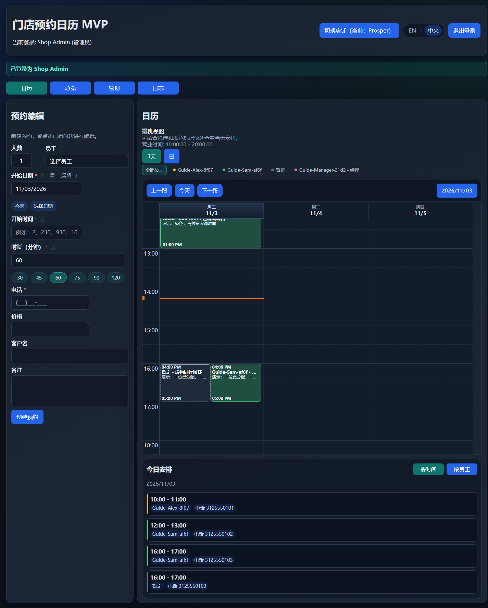
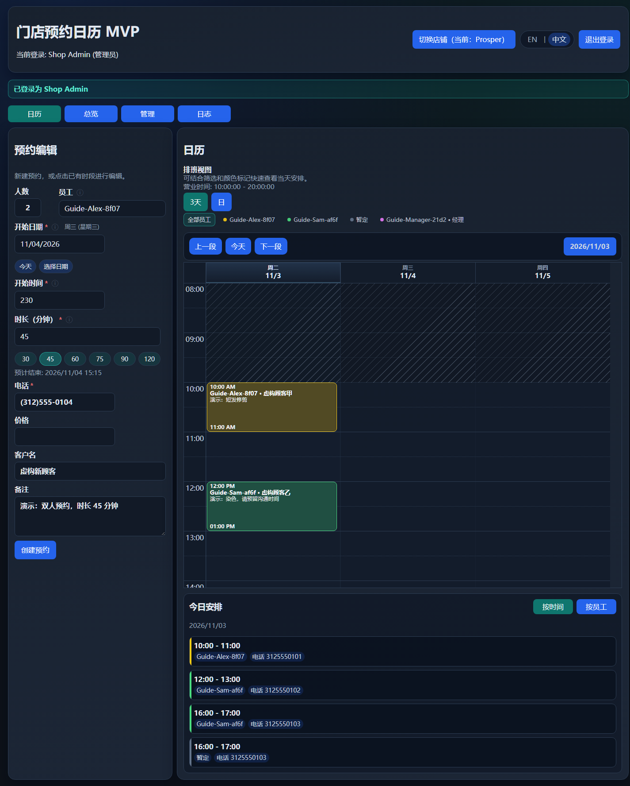
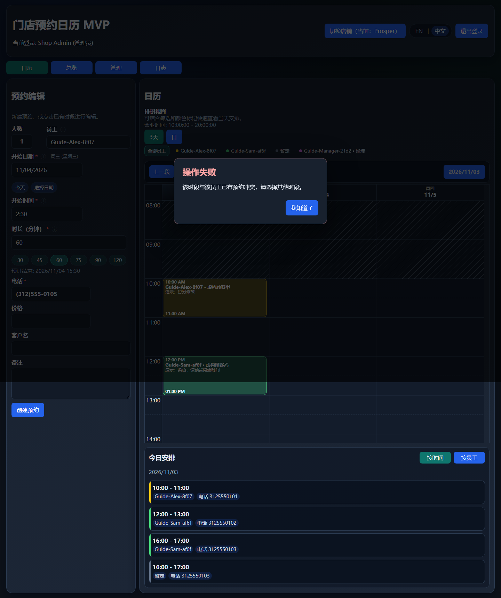
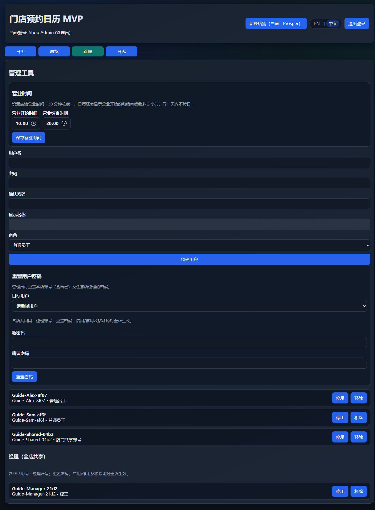
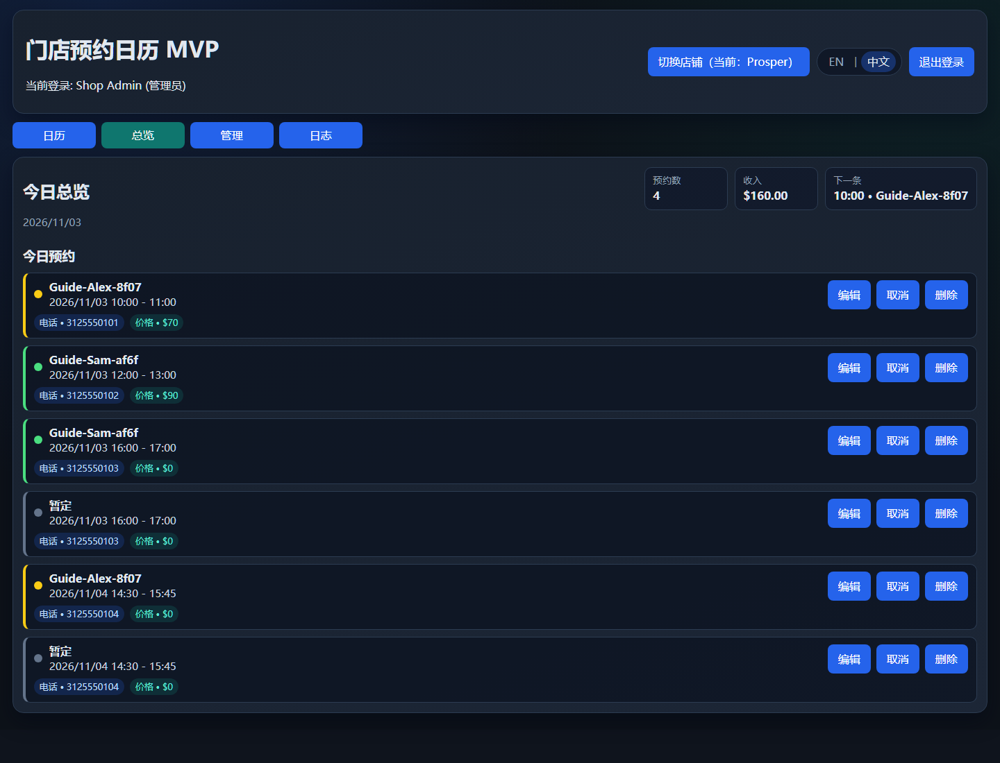
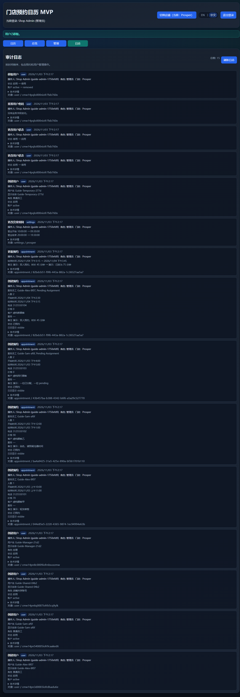

# 门店预约日历：中文用户使用说明书

## 目录

1. [角色与可见功能](#1-角色与可见功能)
2. [登录、选店和退出](#2-登录选店和退出)
3. [查看日历与今日安排](#3-查看日历与今日安排)
4. [创建预约：完整操作](#4-创建预约完整操作)
5. [修改、移动和调整时长](#5-修改移动和调整时长)
6. [取消与删除预约](#6-取消与删除预约)
7. [管理员设置与账号管理](#7-管理员设置与账号管理)
8. [总览与审计日志](#8-总览与审计日志)

## 1. 角色与可见功能

| 功能 | 管理员 ADMIN | 经理 MANAGER | 普通员工 EMPLOYEE | 店铺共享账号 SHOP_ACCOUNT |
|---|---|---|---|---|
| 登录后进入店铺 | 先选店 | 先选店 | 直接进入所属店 | 直接进入所属店 |
| 切换店铺 | 可以 | 可以 | 不可以 | 不可以 |
| 查看当前店全部预约 | 可以 | 可以 | 可以 | 可以 |
| 新建、编辑他人预约、移动、调整时长 | 可以 | 可以 | 可以 | 可以 |
| 新建过去时间的预约 | 可以 | 可以 | 不可以 | 不可以 |
| 修改现有预约到过去时间 | 可以 | 可以 | 可以 | 可以 |
| 取消预约 | 可以 | 可以 | 可以 | 可以 |
| 删除/隐藏预约 | 可以 | 可以 | 不可以 | 不可以 |
| 总览、审计日志 | 可以 | 可以 | 无此入口 | 无此入口 |
| 修改营业时间、管理账号 | 可以 | 不可以 | 不可以 | 不可以 |
| 作为服务人员被分配 | 不可以 | 可以，全店共享 | 可以，限所属店 | 不可以 |

- “能看见预约”不代表只能编辑自己的预约：当前店内人员共享预约内容，普通员工和共享账号也可编辑其他服务人员的预约。
- 人员颜色由系统持久保存，当前页面没有手工选色功能。经理跨店使用同一个身份及颜色。
- 管理员可在账号管理的“员工颜色”中，为本店普通员工预览系统自动分配的新颜色，再确认保存；该员工已有预约（包括过去、已完成、已取消及已删除记录）的颜色快照会一并同步。
- “暂定”（英文界面可能显示 pending）是系统待分配占位，不是真正可登录接单的员工。
- 创建账号时可选普通员工、经理或店铺共享账号；**不能通过此页面创建管理员**。

## 2. 登录、选店和退出

### 2.1 首次登录

1. 打开管理员提供的网站地址。
2. 需要中文时点击页面上的 **中文**；英文界面对应 **EN**。浏览器会保存语言选择，首次默认英文。
3. 输入管理员分配的用户名、密码，点击 **登录**。
4. 密码错误、账号停用或已移除时会出现登录错误；联系管理员核对或重置，不要反复创建新账号。

### 2.2 管理员和经理选店

1. 登录后在“选择店铺”页点击目标店名（截图示例为 Anna / Prosper）。
2. 点击 **继续**，确认右上角“切换店铺（当前：…）”显示正确店名。
3. 日常切店时，点击右上角 **切换店铺**，选择目标并继续。
4. 不想切店可点击 **取消**；首次选择时可 **返回登录**。
5. 加载店铺失败时点击 **重试加载店铺**。没有可选店铺时不要继续操作，联系管理员。

普通员工与店铺共享账号没有选店步骤，也没有切店按钮。

### 2.3 退出与重新进入

- 点击右上角 **退出登录**。当前浏览器保存的登录信息会被清除，日历实时连接关闭。
- 刷新页面时，应用会尝试恢复登录；登录过期或管理员修改账号后可能要求重新登录。
- 退出按钮是当前浏览器退出，**不是“注销全部设备”功能**。公共设备用完必须退出，不要共享管理员密码。
- 当前没有自助注册、忘记密码邮件或员工自助修改密码界面；找管理员处理。

## 3. 查看日历与今日安排

### 3.1 页面布局

- 桌面左侧是 **预约编辑**，右侧是 **日历**，其下是 **今日安排**。
- 管理员/经理还可使用顶端 **日历 / 总览 / 日志** 标签；只有管理员有 **管理**。
- 手机上编辑器和日历上下排列，需向下滚动才能看见日历。
- 默认展示 **3天**，可点 **日** 查看单日。

### 3.2 找到日期与人员

每次刷新或重新打开页面默认显示一日；三日需手动选择。本次页面打开期间，切换面板、导航日期或调整窗口大小会保留当前视图选择。

1. 点击 **上一段 / 下一段**：3天视图每次移动三天，日视图移动一天。
2. 点击日历工具栏的 **今天** 返回今天。
3. 点击工具栏显示的日期，打开日期选择器，跳到指定日期。这个跳转**不修改左侧预约草稿**。
4. 点击人员颜色标签筛选；再点同一人员会保持该筛选，点击 **全部员工** 恢复全部。
5. 人员筛选同时影响日历和今日安排，但不替你修改预约的人员分配。

**注意两个“日期”不是一回事：**

- 编辑器的“开始日期”只显示日期，禁止键入、粘贴或清空；仅通过“今天”或“选择日期”的日历按钮修改。“今天”沿用设备本地日期语义。
- 日历上方的日期及“今天”用于移动可视日历；不能代替填预约时间。

### 3.3 阅读卡片和今日安排

- 卡片显示开始、实际结束时间、人员、客户名及备注（空间不足时文字会截断）。
- 日历网格时间轴使用 24 小时格式；卡片开始/结束可能使用 AM/PM，编辑上下文与今日安排使用相应展示格式，不要把 `02:30 PM` 看成凌晨。
- 员工用固定颜色区分；暂定记录与已取消记录有不同样式，已取消仍可见。
- **今日安排**可切换 **按时间 / 按员工**。它是设备本地“今天”，不是日历工具栏当前所选日期。
- 备注被截断时可查看详情；触屏设备会使用独立备注浮层，点空白区域或关闭按钮收起。未截断的备注不一定弹层。
- 营业时间之外会显示背景区分。日历还显示开门前/关门后各最多两小时，范围不跨过同一天。

## 4. 创建预约：完整操作

### 4.1 开始新草稿

1. 正在编辑已有预约时，先点击 **取消** 返回新建模式（这不是“取消预约”，不会改变原预约状态）。
2. 可以在编辑器直接填写，也可以点击营业时间内的日历空白格自动带入日期和开始时间。
3. 点击空白格切换为新建时，注意检查已有客户/电话/备注等草稿字段，不要误用上一位顾客信息。
4. 确认主按钮是 **创建预约** 而不是 **更新预约**。

### 4.2 人数与员工

1. 在 **人数** 填写本次服务人数，范围 1–99；默认 1。
2. 打开 **员工** 下拉框，勾选已确定的服务人员。
3. 每位勾选人员生成一条记录，剩余人数自动生成“暂定”记录。
4. 例如人数 3，只选 Alex：保存后同组有 Alex 一条、暂定两条。也可以完全不选，全部暂定。
5. 人数为 1 时，勾选另一员工会替换之前的选择；多人时超过人数上限会提示错误。
6. 减少人数并离开输入框时，超出的人员选择会被裁减；保存前重新核对。

暂定允许时间重叠；实际人员同店同一时段不能重复安排。暂定不是“已经安排好员工”。

### 4.3 日期、开始时间和时长

| 字段 | 输入方式与规则 |
|---|---|
| 开始日期 | 以 `MM/DD/YYYY` 显示；不可输入或清空，仅可点击今天、选择日期 |
| 开始时间 | 手动只输入 1–4 位数字，不输入冒号、AM/PM 或“下午” |
| 时长 | 正整数分钟；默认 60，快捷按钮 30、45、60、75、90、120 |
| 结束时间 | 系统按开始时间与时长计算，不直接填写 |

开始时间示例（营业时间为 10:00–20:00）：

- `10` → 10:00；
- `2` → 下午 2:00（14:00）；
- `230` → 下午 2:30（14:30）；
- `1030` → 10:30。

输入中保持原始数字，离开字段后才格式化。营业时间决定上午/下午：必须只有一个候选时间在营业时间内。比如 `930` 在 08:00–20:00 可表示早上 9:30，但在 10:00–20:00 时两个候选都不在窗口内，不能保存。

- 输入格式错误、营业时间内同时匹配上午和下午，或均不匹配时，按错误提示处理。
- 时间字段旁的说明按钮可点击/聚焦查看规则，按 Esc 或点外部关闭。
- 网格与拖拽吸附是 **30 分钟**；不意味着时长只能填 30 的倍数，45、75 分钟均支持。
- 手动开始时间可包含有效分钟，并非强制每半小时起约。
- 开始时间需在营业时间内；预计结束可以晚于关门，但不能跨到次日。超过 180 分钟会额外确认。
- 普通员工/共享账号不能新建过去预约；管理员/经理可补录。编辑既有预约的过去时间权限与新建不同。

### 4.4 电话、价格、客户名和备注

1. 输入 **10 位电话数字**，例如演示号码 `3125550104`，界面显示为 `(312)555-0104`；提交的是数字。
2. 不要加美国国家码 `1`、分机或国际号码。这里只接受十位电话号码；粘贴后请再次核对显示的号码。
3. 填满电话后会查询**当前店铺**的历史客户名与备注，自动补充尚未手改的字段。手工改过的字段不会被后来的查询结果覆盖。
4. **价格选填**，单位美元。新建留空保存为 0；填写时用 `70` 等非负整数，不要输入 `$70`、`70.00`、`70.50`、负数或科学计数法。
5. 既有历史小数价格可以显示并原值保留；只改其他字段时不要重输价格。若确实要改价，新值需为整数美元。
6. 客户名与备注可不填。服务项目可写在备注；表单没有单独的服务项目输入框。

**多人价格提醒：** 当前同组价格会写入每条成员记录，不是自动分摊的整组总价。不要把一个总价填进多人预约后，直接把“总览收入”当作真实营业收入。

### 4.5 确认保存

1. 核对店铺、人数、人员、日期、预计结束、电话和价格。
2. 点击 **创建预约**。
3. 成功后显示“预约已创建”，编辑器重置；日历出现相应卡片。
4. 同人同店时间冲突时显示错误弹窗；点 **我知道了**，修改时段或员工后再试。错误不会替你自动选其他人。
5. 如果提示“已成功保存，但视图刷新失败”，**不要重复提交**，点击 **重试**刷新视图，避免重单。

## 5. 修改、移动和调整时长

### 5.1 编辑预约

1. 点击日历已有卡片，或总览里的 **编辑**。
2. 确认编辑器显示“已选预约”，主按钮变为 **更新预约**。
3. 多人预约会加载同组全部成员。修改人数/人员时，检查暂定数量是否符合预期。
4. 修改日期、时间、时长、人员、电话、客户名、备注或价格。
5. 点击 **更新预约**；成功后回到新建模式。
6. 点 **取消**仅放弃编辑草稿，不会取消业务预约。

### 5.2 拖拽移动与拉长/缩短

1. 在桌面鼠标拖动卡片到目标日期/时间，网格按半小时吸附。
2. 鼠标移入卡片后，从底部调整手柄拖动可改变结束时间。
3. 保存成功后刷新显示；发生冲突时弹出提示并回滚，不要认为“拖过去看到了”就已保存。
4. 多人组通过其中一张卡片移动或调整时长，后端会同步整组。
5. 已取消的卡片不允许拖拽/调整，也不能继续更新。
6. 触屏操作较难精确命中手柄时，直接用编辑器修改时间和时长更可靠。

两段预约“前一段结束 = 后一段开始”允许衔接；部分重叠、包含、完全重复均会拦截。保存时系统会再次检查冲突；发生冲突时预约不会保存。

## 6. 取消与删除预约

| 操作 | 入口 | 结果 |
|---|---|---|
| 放弃编辑 | 编辑器的 **取消** | 不改预约，只返回新建 |
| 取消预约 | 编辑器 **取消预约** / 总览行 **取消** | 确认后整组变为已取消；保留可见、释放人员时段 |
| 删除预约 | 管理员/经理的 **删除预约** / 总览行 **删除** | 确认后整组软删除，在普通列表隐藏；数据库及审计保留 |

- 普通员工和共享账号没有删除入口，只能取消。
- 已取消预约可以查看，不能再次更新或取消；管理员/经理仍可删除。
- 当前没有“撤销取消 / 恢复已删除”的 UI。不要把删除当作临时隐藏开关。
- 对多人预约操作前确认整组范围，避免只想取消一位却取消整组。

## 7. 管理员设置与账号管理

只有管理员可进入 **管理**。经理虽然能跨店、删预约和看日志，不能管理账号或营业时间。

### 7.1 设置营业时间

1. 确认右上角当前店铺。
2. 在管理页输入营业开始、营业结束时间，按 **30 分钟**粒度选择。
3. 开始必须早于结束，不能设置跨午夜营业窗口。
4. 点击 **保存营业时间**；回到日历核对营业时间标签及背景。
5. 尚未设置营业时间时，默认营业时间为 10:00–20:00。不同店铺分别保存。
6. 修改窗口不会自动调整既有预约；编辑原有非标准时间时，系统会尽量保留未改动的原始开始时间。

### 7.2 创建账号

1. 在管理页填写用户名、密码、确认密码。
2. 密码至少 6 个字符，两个密码必须一致。
3. 显示名称与用户名相同，不能单独设置昵称。
4. 角色选择普通员工、经理或店铺共享账号。
5. 点击 **创建用户**，确认成功提示及列表中出现新账号。
6. 普通员工/共享账号属于创建时的当前店；经理是全店共享身份。
7. 通过安全方式单独交付账号密码，不要写在备注、日志或群截图中。

### 7.3 停用、启用、移除

- 对目标人员点击 **停用**：禁止其登录/继续使用旧会话；需要恢复时点击 **启用**。
- 停用不是删除，也**不会自动把已有未来预约转给别人**。查看安排并人工处理。
- 点击 **移除**并确认：账号软删除，不能再登录；未来尚未开始、未取消/未删除的已排预约会转为对应店铺的暂定，历史预约保留快照。
- 经理区域标注 **经理（全店共享）**。对经理停用、移除、重置密码会影响所有店铺；移除经理可能重分配多个店铺的未来预约。
- 当前登录管理员本人不在下方可停用/移除列表内；管理员账号没有移除按钮。不要尝试处理系统“暂定”占位账号。

### 7.4 重置密码

1. 在“重置用户密码”的目标用户下拉框选择账号。
2. 输入新密码及确认密码（至少 6 个字符）。
3. 点击 **重置密码**。
4. 把新密码安全交给对方；旧密码及旧会话不再可用。
5. 选择自己时，重置成功会立即退出，需用新密码登录。
6. 经理在全店共享分组中；这里只能重置本店账号及所有经理，不能借切店访问普通员工的非授权店铺信息。

### 7.5 重新分配员工颜色

1. 管理员进入管理页，在“员工颜色”并排查看本店员工现有颜色（含已停用员工）。
2. 对目标员工点击 **预览重新分配**，查看候选颜色；系统沿用自动配色逻辑，不提供手工挑色。
3. 点击 **确认颜色**才保存；点击 **取消**或仅预览不会保存。
4. 若期间其他人改变颜色分配导致预览失效，重新预览后再确认。
5. 确认后，该员工当前归属的全部预约颜色快照（包括过去、已完成、已取消及已删除记录）都会同步为新颜色；已转给其他员工的预约和系统“暂定”记录不受影响。后续新建或重新分配给该员工的预约使用新颜色。经理和系统“暂定”不支持此操作。

> 本次文字说明已更新，现有截图及 PDF 尚未重新生成，界面细节以当前页面为准。

## 8. 总览与审计日志

### 8.1 总览：查看预约与参考统计

点击 **总览**可看到预约数、收入、下一条及预约列表，并可逐行编辑/取消/删除。

**统计口径与使用注意事项：**

- 顶部统计按设备本地“今天”筛选，但会计入已取消预约，按成员记录计数和累加价格，不按客户组去重。
- “收入”是记录价格之和，没有收款、退款、完成状态的财务核销流程。
- “下一条”目前取今天最早一条，不保证是当前时刻之后最近一条，也可能已取消。
- 下方虽标“今日预约”，实际渲染当前加载的全部预约，可能包含明天或历史数据。
- 请核对预约日期、状态和实际收费记录；总览数据仅供参考，不应作为精准经营或财务报表。

### 8.2 审计日志

1. 管理员/经理点击 **日志**。
2. 查看操作类型、时间、操作人/角色、所属门店，以及关键字段前后变化。
3. 需要核查原始信息时展开 **技术详情**，可看人员/店铺快照及变更前后数据。
4. 点击 **刷新日志**重新加载。自动加载失败会在页面提示，手动刷新失败可能弹错误窗。
5. 部分历史记录可能显示“旧记录缺少变更详情”；遇到未知格式时可查看原始详情，系统不会补造历史差异。

日志页面最多显示最新 **100 条**，同时显示总数，但没有翻页、检索或导出功能。页面只显示 100 条不代表更早的日志已删除。日志属于当前选定门店；经理跨店操作的影响应到相关店铺分别核查。
